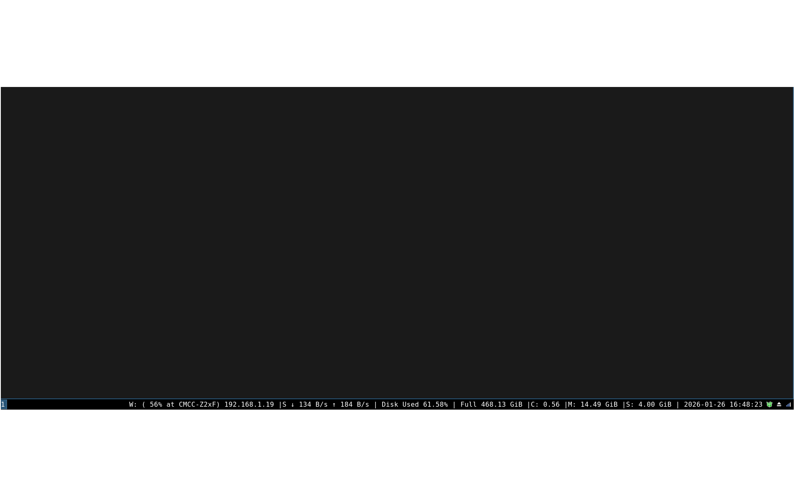

# experimental i3status cli in go

# build and install

```bash
go build -o i3statusgo cmd/i3statusgo.go

# will install to your $GOPATH/bin, usually at $HOME/go/bin, should add $HOME/go/bin to your $PATH
go install cmd/i3statusgo.go

# or
go install -x -v -a -race -msan -asan -work gitee.com/EEPPEE_admin/i3statusgo@latest
```

# screenshot

- C stand for CPU, M stand for Memory, S stand for Swap
  Full stand for Full Disk Total, Disk Used stand for Disk Used Percentage
  W stand for Wifi name, S stand for net speed(I guess, I don't know how to show net speed)
  

# setup for i3 config in `~/.config/i3/config`

```bash
bar {
    #status_command i3status # original i3status program
    # NOTE: path to your i3statusgo binary
    status_command ~/go/bin/i3statusgo
    position bottom
    # NOTE: since I output so many thing and mark text of them, maybe the font size should not be too large
    font pango:DejaVu Sans Mono 12
}
```

# ref links

-learn how to setup package executable from goreleaser: https://github.com/goreleaser/goreleaser/blob/main/go.mod

```bash
# here is idea
go install github.com/goreleaser/goreleaser/v2@latest
# and the go.mod define below
# module github.com/goreleaser/goreleaser/v2
# and the main.go is in root folder

# so I guess, I don't need to setup cmd/ folder, just expose i3statusgo.go into root folder
```
